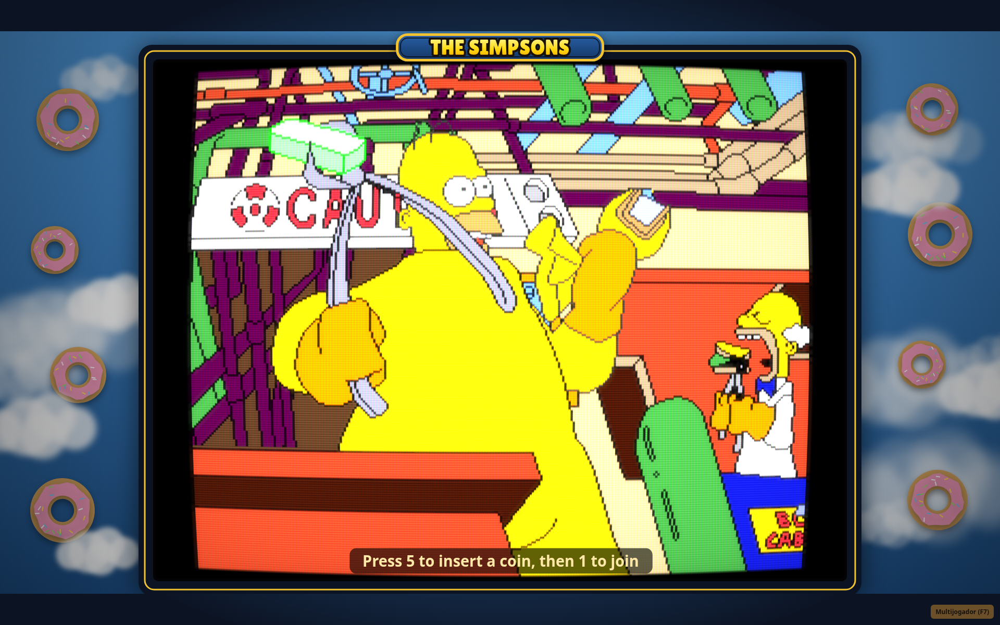
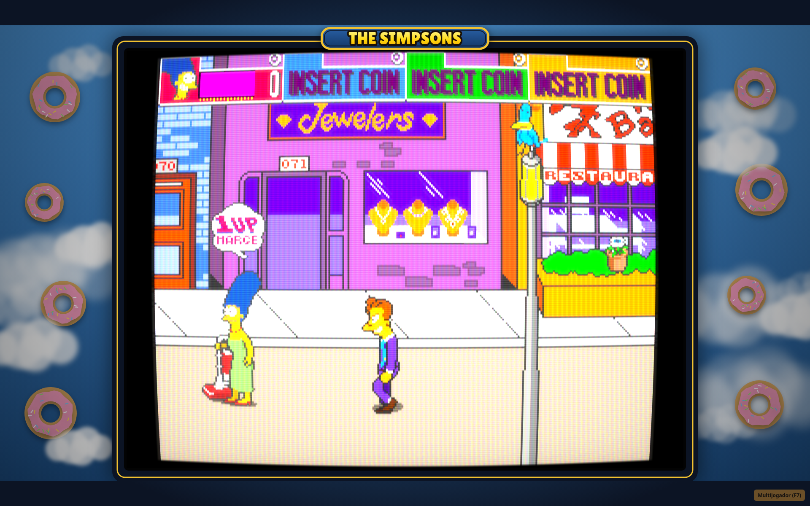

# The Simpsons — browser arcade

A browser player for Konami's 1991 arcade game *The Simpsons* (MAME set `simpsons`, 4-player world). It runs the game by emulating the board: its own interpreter for the KONAMI 053248 CPU (the 6809-derived core on that PCB), a Z80, a YM2151, and a K053260, and it draws the K052109 tilemaps, K053247 sprites, and K053251 mix onto a 320×224 canvas. The usual view adds a WebGL CRT shader and a 16:9 frame drawn by the page.

The CPU, sound, and video were compared with MAME while they were written. This is an emulation. It is not a decompilation of the program into another language, and it is not an official Konami or Fox product.

The game ROM is not in this repository. You bring a legally obtained MAME `simpsons.zip`.

## Pictures

Both frames are from a run of this page, with the CRT shader on and the 16:9 frame drawn by the page.

<p align="center">

<br>
<em>Attract mode inside the original 16:9 bezel with CRT filter.</em>
</p>

<p align="center">

<br>
<em>Stage 1 gameplay (Marge, single player).</em>
</p>

## What the page does

- One to four players, on the keyboard or on gamepads.
- Online rooms for four players. The host keeps the match in step with rollback: a late input is replayed from a saved frame, and sound from a replayed frame is not sent to the speakers twice.
- Chat. Tab opens the line, Enter sends it, Esc cancels. A player's line is drawn in a bubble over that player. A spectator's line is drawn at the top of the picture, with the name.
- A full room can still be watched, up to four spectators. A spectator can take an open player slot (coin, or the button in the panel).
- A public room list, or a private room that is reached only by the link or the code.
- Nicknames, stored in this browser and drawn with the player.
- Three ways to see the picture: the default CRT and drawn frame, CRT alone (`?gfx=crt`), or sharp pixels (`?gfx=orig`). `?webgl=0` skips the shader. The frame is procedural page art. It is not a photograph of a cabinet and it is not Konami artwork.

## Start

Serve the `web/` directory over HTTP or HTTPS. A `file://` address breaks the ROM picker, the invite link, and WebRTC.

With XAMPP, point the Apache document root at this repository (the root `index.html` only forwards to `web/index.html`) or at `web/` itself, then open the site from `http://localhost/`.

From a checkout, this also works:

```bash
cd web
python3 -m http.server 8080
```

Open `http://127.0.0.1:8080/`. The page asks you to choose `simpsons.zip`. The zip is checked by CRC32, whatever the file names inside it are, then kept in IndexedDB on that machine. It is not uploaded.

A private checkout can place the extracted `assets/*.bin` files next to `web/index.html`. `web/romload.js` will use those and skip the picker. That folder is gitignored. Do not commit the bins or the zip. `node tools/make_pc.js` builds such a folder under `dist/` from your local zip; that output contains the ROM and must stay on your machine.

The loader accepts the 4-player world chips at these CRC32 values:

| File | CRC32 | Role |
|---|---|---|
| `072-g02.16c` | `580ce1d6` | KONAMI program |
| `072-g01.17c` | `9f843def` | KONAMI program |
| `072-j13.13c` | `aade2abd` | KONAMI program |
| `072-j12.15c` | `479e12f2` | KONAMI program |
| `072-e03.6g` | `866b7a35` | Z80 program |
| `072-b07.18h` | `ba1ec910` | K052109 tiles |
| `072-b06.16h` | `cf2bbcab` | K052109 tiles |
| `072-b08.3n` | `7de500ad` | K053247 sprites |
| `072-b09.8n` | `aa085093` | K053247 sprites |
| `072-b10.12n` | `577dbd53` | K053247 sprites |
| `072-b11.16l` | `55fab05d` | K053247 sprites |
| `072-d05.1f` | `1397a73b` | K053260 samples |
| `072-d04.1d` | `78778013` | K053260 samples |
| `simpsons.12c.nv` | `ec3f0449` | ER5911 EEPROM |

Each player inserts a coin and presses start, as on the cabinet. High scores and settings from that EEPROM are kept in `localStorage` after the first boot.

| | Move | Attack | Jump | Coin | Start |
|---|---|---|---|---|---|
| Player 1 | arrows or W A S D | Z or J | X or K | 5 | 1 or Enter |
| Player 2 | numpad 8 / 4 / 5 or 2 / 6 | numpad 0 or N | numpad . or M | 6 | 2 |
| Player 3 | gamepad | gamepad | gamepad | 7 | 3 |
| Player 4 | gamepad | gamepad | gamepad | 8 | 4 |

On a gamepad, the pad or stick moves, A attacks, B jumps, Select is the coin, and Start is start (X and Y also attack and jump when the Arcade Remix is off). Pad order follows the browser's pad list: the first pad is player 1. F2 holds the service switch.

F7 opens and closes the multiplayer panel. There is also a button on the page.

Use **Pause (P)** or press **P** to pause and resume offline play. **Mute audio (F8)** or **F8** turns off all music and sound effects; this setting is remembered in the browser. Muting works online too. Pause is unavailable in online rooms so the players stay in sync.

## Arcade Remix combat and run upgrades

Offline play adds more moves to every character. Each move works on top of the original game's own walking, attacking and hit detection:

| Move | Keyboard | Gamepad | What it does |
|---|---|---|---|
| Attack chain | Z or J | A | Confirmed hits build a combo; every third hit is a finisher. **Up + Attack** is a launcher, and air hits juggle. |
| Heavy attack | V or L | X | Winds up (the character leans back and flashes), dashes in and lands a **SMASH** for about 1.6x damage with big knockback. |
| Signature move | F or I | Y | One per character, on a recharge shown by the pip under the score panel. **Marge** vacuums enemies toward her, then blows them away. **Homer** belly-bumps through a crowd and takes half damage while charging. **Bart** fires three slingshot rocks across the screen. **Lisa** plays a sax solo whose sound waves stun everyone in front of her. |
| Roll | C or U | LB (or LT) | The character tumbles along the floor, invulnerable for most of it. Hold up or down to roll into or out of the stage. Rolling through a real enemy hit is a **perfect roll**: it refunds focus and opens a one-second counter window with +50% damage. |
| Focus Burst | Q | RB | Spends 50 focus on a nearby-area knockdown; hits and KOs build focus. |
| Bowl | B | RT | A free bowling ball with a short cooldown rolls along your depth line; three hits with one ball is a **STRIKE!** |

The roll, heavy wind-up and signature moves are drawn by turning the character's own arcade sprite inside the game's video pipeline (spinning on its side, leaning, a belly that swells), with afterimages, dust, speed lines, the vacuum stream, sound waves and rocks drawn over the picture. All Remix screens are drawn inside the game picture, so they scale with it and get the CRT effect; headings and callouts use the arcade's own 8x8 font read from your ROM. Each active player has a strip under their score panel, edged in that panel's colour, with a focus meter (the white tick marks the Focus Burst cost), the signature pip, the combo count and a blinking COUNTER during a counter window. Callouts such as SMASH! appear above the player. Press **H** for an in-game how-to-play page that lists the moves, each character's signature and the items you hold. **N** on that page starts a new run. Basic enemies receive enough health to support multi-hit combat. Finishers, launchers, smashes and counters get a short hit-stop, screen shake and callout (skipped with reduced motion). From stage 2, some enemies spawn as **elites**: they wear a crown and have extra health, and when one falls it drops a Springfield snack (a donut, a Squishee or a Krusty Burger) that you walk over to eat for health and focus.

Clearing a combat stage holds the game and shows an in-game results screen (time, best combo, KOs, damage taken, elites, counters) with an S–C rank above a seeded choice of Springfield items, each with its own pixel-art picture. Pick with left/right and Attack, the keys 1–4, a gamepad, or a mouse click on a card. Items are common, rare or epic: rare and epic items add synergies such as Sugar Rush (long combos hit harder), Bowling Pin (air hits pop enemies back up), Boxing Glove (stronger counters), Lucky Clover (faster signature recharge), Uranium Rod (finishers hit nearby enemies) and Plant Battery (cheaper, wider Focus Burst). An A rank guarantees a rare or epic item; an S rank adds a fourth. Buzz Cola (damage), Hockey Pads (armor), Pink Donut (maximum health), Krusty Burger (healing on KOs), Skateboard (speed), Comic Book (focus gain), Squishee (combo duration), Roller Skates (roll), Steel-Toe Boots (heavy attacks) and Family Dinner (full heal) also carry through the run. Picking an item shows it on screen for a moment. Stage 4's two parts share one upgrade checkpoint; bonus rounds do not grant another draft. Reaching the ending completes the run. Returning to the title resets upgrades.

These gameplay modifications are offline. Use `?mods=0` for original behavior and online play, or `?combat=0` to disable the combat/run systems while retaining editor scenery and characters.

## Stage editor

Open `editor.html` on the same server to paint the two scrolling background layers, save edits in this browser, and export or import edits as JSON. **Play this stage** automatically starts a player in the selected stage and skips displaying startup and introductions. The first launch prepares the game in the background; subsequent launches restore a private browser checkpoint. Editing the stage invalidates that checkpoint. Background edits change scenery while collision stays unchanged. Shared map data can make an edit appear in several places.

Select **Enemies** to add Slugger, Rivet, Duffman, Hans Moleman, Comic Book Guy, Fat Tony and his crew (Wiseguy, Mob Boss), the Rich Texan, Mr. Burns, Moe and paddle-swinging Jasper in Stonecutter robes, nine PixelLab-animated guest characters (Hoodie Girl, Nanny, Cat Lady, Princess, Jacket Artist, Purple Suit, Accordion Guy, Blonde Woman, Glasses Woman), or a standard enemy, drag spawn markers, or remove basic enemies. Slugger is a man inside a giant baseball mascot costume; Rivet is an original maintenance goon in a navy cap, orange vest and teal coveralls. Custom characters have sixteen animation frames, individual 16-colour palettes and a 48×72 display size (the six converted from sprite sheets by `tools/build_sheet_enemies.py` stand at arcade goon height instead). They use the original standard enemy's combat behavior. Enemy edits support undo/redo and export/import. Stage scripts and other object records stay in the spawn stream. Use Main for placement; markers describe spawn coordinates, and the original game decides when enemies enter the screen.

The Enemies view also shows the stage's own characters and props (goons, the dog, Principal Skinner, the kid, doors, fence panels, street lamps and more) drawn with their real in-game sprites, which the editor renders from your ROM. Names appear when you hover over or select a marker. Drag one to move it, delete it, or pick one of the stage's object types under **Place** to add another. **Show scripts & triggers** adds grey markers for event records, such as the police car arriving at the fire station. Those records cannot be moved, but **Duplicate group to X** copies an event together with the records next to it, for example a fence and the goons that break through it (experimental). Objects that were not captured show as plain boxes labelled by object number.

Select **NPCs** to place a friendly custom character, edit its name and dialogue, and move or delete it with the same tools. NPCs never attack, take damage or count as enemies. A blue name label identifies them in game; approach and press **E** to talk. Dialogue pauses gameplay until closed. NPC data is included in the editor's save, undo/redo and JSON export/import.

**New stages.** Choose **+ New stage…** in the Stage list to build a level of your own. The original stages are never changed by this. A custom stage plays on an original stage's ground (its walkable floor, collision and enemy script) with its own background art, enemy list and scripted events. It appears under **Your stages** in the Stage list; **Play this stage** starts it (`index.html?custom=<id>&play=1`). **Rename** and **Delete stage** manage it. Starting points:

- **Springfield Elementary** (on Stage 1's ground): a schoolyard with a brick school, a school bus and a gym, then an indoor hallway with lockers, classrooms and a trophy case.
- **The Android's Dungeon** (on Stage 1's ground): a street of red-brick shops leading to the comic book store's green front, with its sign, purple-and-white awning, the cardboard robot in the window and the OPEN door; then the inside of the shop, with shelves of boxed action figures, a comic rack, longboxes and the glass counter with the blue register.
- **Bowling Alley** (on Stage 2's ground): twenty lanes with pins, ball returns, score monitors, a pro shop, a snack bar, shoe rental and an arcade corner. Only the amusement park's main section gets the new art; the later funhouse sections keep their original look, and the park's vendors (characters, not background) appear until you move or delete them in the Enemies view.
- **Copy of** any combat stage, with its original art.

The **Level art** menu switches a custom stage's art, and the block picker lists that art's blocks for painting. Sections outside the art (for example the funhouse) show the original ground and cannot be painted from a custom stage. Interactive props drawn on the game's fixed layer (doors that enemies come out of, breakable fences) keep their original style. Edits made before custom stages existed, which put level art on an original stage, are turned into custom stages automatically.

**Events** places scripted events in a custom stage. An event fires once, when the camera brings its X to the middle of the screen. Drag a marker to move it; right-click or Delete removes it. The Bowling Alley has four:

- **Runaway ball**: after a flashing warning on one player's lane, a giant bowling ball rolls across the screen and knocks down everyone it reaches, players and enemies alike. Jump or dodge it.
- **Pin storm**: pins rain from the pinsetters around the players for about 5 seconds; each lands on its shadow and bonks whoever is under it.
- **Cosmic bowling**: the lights go out and the alley glows in blacklight neon for 12 seconds.
- **Ball-return frenzy**: for 10 seconds bowling balls (B / RT) have almost no cooldown.

**Describe a new event** (top of the Events panel) makes an event from your own words, in any custom stage, with or without level art. Type something like "The lights go out and giant donuts rain from the sky for 8 seconds" and press **Create event**. The event is placed in the middle of the visible map, and it is also added to the Place menu (✨) so you can click more copies onto the map. Select a described event to see its description again; edit it and press **Remake selected event** to rebuild it in place.

Events are built from a fixed set of building blocks: objects that roll or fly across the screen along a lane (bowling balls, pins, donuts, boulders, fireballs, Duff cans, bombs, pies, anvils), objects that rain from the sky, blasts, screen tints (lights out, blacklight, red alert, toxic green, sepia, negative, white flash), screen shake, healing, free bowling balls and on-screen messages, each with its own timing, target (players, enemies or everyone), damage and knockdown or flinch. No generated code is run. Things outside these blocks, like spawning characters or changing the music, are not possible yet; the editor says what was left out.

- **Without a key**, a built-in reader picks the blocks from common words (rain, roll, explosion, earthquake, lights out, heal, donuts, boulders, ...).
- **With a Claude API key** (open "Claude API key" under the box), Claude reads the description and builds the event. The key is kept in this browser's storage and is sent only to the Claude API, straight from the page. Each event costs one request to `claude-opus-5-5`.

Use `?mods=0` for online play with the original ROM. The editor's local edits and scene selection are disabled on room invite links; a modified offline game asks you to open a fresh unmodified page before creating or joining a room. See [the format and usage notes](docs/stage-format.md) for limitations and checks.

## Playing online

Create a room from the panel. The invite is this page's own address plus `?sala=` and a short code. Each person opens that link in a browser, then uses coin and start.

In an online room, that browser's controls belong to that browser's player. Four people need four browsers, not four seats at one keyboard.

Signaling (the room list, the offer, the answer, and ICE) uses:

`https://games4me.alwaysdata.net/simpsons/signal.php`

When a room is opened, the page asks that server for short-lived TURN credentials (`?a=ice`). No relay password is stored in the browser. The static Open Relay credential that an earlier copy of `web/net/transport.js` embedded is not in this tree, the same choice as the public Cadillacs player, which also dropped its embedded relay secret. If the request fails, the page keeps the public STUN servers and does not substitute another relay account. If a direct connection does not come up and TURN was returned, the guest tries once more through the relay only.

`?signal=` points at another copy of `signal.php`. `?net=peerjs` uses the PeerJS broker instead. `?turn=` is a local test override and is not copied into the invite. Do not put a relay password in a link you share.

`web/net/signal.php` is the signaling program for someone who hosts their own copy. This repository does not deploy it. A real host copies `web/net/turn_config.example.php` to `turn_config.php` on that server and fills it there. The filled file is gitignored. Do not commit it, and do not ship it with the page. The stats view (`?a=stats&k=`) reads `stats_key` from that same file; the key is not in this repository.

## A code-only package

From the repository root:

```bash
python3 tools/make_itch.py
```

That writes `dist/simpsons_itch_<stamp>.zip`, which is gitignored. The zip holds the page's scripts, HTML, and the OFL font. It does not upload anywhere. It refuses to pack a ROM: a file whose CRC32 or size matches a chip or an extracted image fails the build.

## Tests in this tree

These are the scripts that are actually here. None of them contain the game ROM, a MAME trace, or an input movie. The comparison scripts read those from your machine (`roms/simpsons.zip`, `run/out/`, `snap/`, `ref/`). Those paths are gitignored and are not part of this repository, so the comparisons are not run by cloning alone.

Simpsons checks that need your zip, and in several cases a MAME log you capture with the Lua under `run/`:

- `test/roms.js`, `test/romload_check.js` — build and check the same images as `web/romload.js`.
- `test/konami_lockstep.js`, `test/konamim_lockstep.js`, `test/board_lockstep.js` — main CPU or the whole board against `run/io_taps.lua`.
- `test/sched_check.js` — scheduler log against a MAME log.
- `test/input_lockstep.js` with `test/input/coin_start_walk.txt` and `run/input_script.lua`.
- `test/video_compare.js` with `run/snaps.lua`.
- `test/audio_render.js` and `test/wav_compare.py` — attract audio against a WAV you supply.
- `test/ym_check.js` — `web/sim/ym2151.js` against a ymfm log you supply.
- `test/state_check.js` — save, load, and rollback on the board.
- `test/net_check.js` — in-process rollback, spectators, chat, nicknames.
- `test/browser_check.py`, `test/test_coin_hint.py`, `test/test_gfx_modes.py`, `test/test_netplay.py`, `test/test_room_list.py`, `test/test_signal_list.sh`, `test/test_relay.py` — page checks. The relay script expects a local `turnserver` unless `SIGNAL` points at a host you run.
- `test/test_stage_editor.py` — editor painting, persistence, imports, online guards, and starting an edited stage in Chromium.
- `test/test_playback_controls.py` — pause/resume, audio muting and persistence, keyboard shortcuts, and the online pause guard.
- `test/test_enemy_editor.py`, `test/enemy_check.js` — enemy editing and custom sprite rendering; the Node check also needs `unzip` on PATH.
- `test/test_direct_launch.py`, `test/launch_check.js` — direct editor launch, cached state restoration with custom sprites, and native initialization of every editor scene. The Node check needs `unzip` on PATH.
- `test/tileset_check.js` — custom level art: the original stage's collision (the player walks the level), the art following the camera, legacy migration.
- `test/custom_stage_check.js`, `test/test_custom_stages.py` — custom stages: the original stage stays unchanged without `?custom`, New stage / paint / export / play / delete in the editor, migration of old level-art edits, and the Bowling Alley events (runaway ball knockdown, pin storm, cosmic bowling palette and restore) placed in the editor and fired in play.
- `test/recipe_check.js`, `test/test_described_events.py` — events from a description: recipes are clamped, the built-in reader's choices, the Claude request (mocked API: model, JSON schema, fallbacks, key header), remaking an event, and described events firing in a stage without level art.
- `test/test_native_characters.py` — the editor lists, moves and launches the stage's own characters; scripts stay read-only.
- `test/combat_unit.js`, `test/combat_native.js`, `test/test_remix_npcs.py` — confirmed hits, native launcher/dodge physics, upgrade drafts/effects/run reset, friendly NPC authoring and dialogue. The native Node check needs `unzip` on PATH.

These do not load the game ROM:

- `test/konami_unit.js` — reset, IRQ, FIRQ, and NMI on a synthetic 64 KB memory image.
- `test/stage_check.js` — patch validation, boot timing, scene selection, and online isolation on synthetic data.

`test/promo_plan_simpsons.js`, `test/promo_live_simpsons.py`, and `test/promo_render_simpsons.py` drive a local capture. They read `roms/simpsons.zip` at runtime and write under `/tmp`. They do not embed ROM bytes.

A few files are still the earlier Sunset Riders layout and are not Simpsons checks: `test/lockstep.js`, `test/machine_check.js`, `test/movie_check.js`, `test/test_web_runtime.py`, and `test/test_itch_iframe.py` (that last one still looks for the Sunset Riders signal host). `tools/extract_prog.py` and `tools/extract_gfx.py` still name the Sunset Riders chips; the browser loader is the Simpsons extractor.

## Credits and notices

Notices for code that is not original to this tree are in `THIRD_PARTY_NOTICES.md`.

- The KONAMI 053248 interpreter (`web/sim/konami.js`, `web/sim/konamim.js`, `web/sim/konamim_core.js`) is a port of MAME's `konami.cpp`, BSD-3-Clause, copyright-holder Nathan Woods, based on the M6809 core copyright John Butler.
- The cycle-split Z80 (`web/sim/z80m.js`, `web/sim/z80m_core.js`) is a port of MAME's `z80.cpp`, BSD-3-Clause, copyright-holder Juergen Buchmueller. The generator comment also names Andrei I. Holub; that name is not in the MAME header that was checked. See the notices file.
- `web/sim/ym2151.js` is a port of ymfm's OPM engine, BSD-3-Clause, copyright 2021 Aaron Giles. Its tables are ymfm's.
- `web/sim/k053260.js` is a port of MAME's `k053260.cpp`, BSD-3-Clause, copyright-holders Ernesto Corvi and Alex W. Jackson.
- `web/sim/sched.js` is a port of MAME's scheduler, BSD-3-Clause, copyright-holder Aaron Giles.
- Lilita One (`web/fonts/LilitaOne-Regular.ttf`) is SIL OFL 1.1, copyright 2011 Juan Montoreano, reserved font name Lilita. The license text is `web/fonts/OFL.txt`.
- PeerJS 1.5.4 (MIT) is loaded from unpkg only when `?net=peerjs` is set. It is not in this repository.

No license is added here for the rest of the tree.

The Simpsons name and characters are trademarks of their owners; the arcade notices credit Twentieth Century Fox Film Corporation, and Konami published the game. KONAMI is a trademark of Konami. This repository is not endorsed by Konami or by the owners of The Simpsons.
